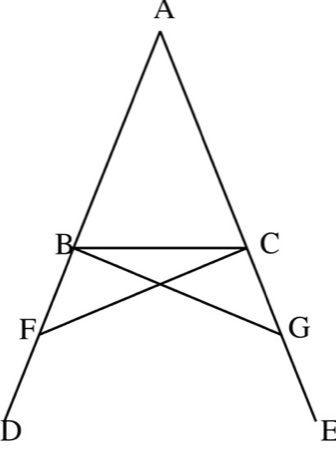

# Euclid's Ruler and Compass

*Στοιχεῖα (Elements)*

**Encyclopedia ID 396** (permanent) · https://bpupadhyaya.github.io/world-heritage-games-site/games/396-euclids-ruler-and-compass/

*Photo: Wikimedia Commons contributor (based on Byrne/Euclid edition), [Public domain](https://creativecommons.org/publicdomain/mark/1.0/), [source on Wikimedia Commons](https://commons.wikimedia.org/wiki/File:Elements_of_Euclid_page_011_figure_01.svg)*

Using only a straightedge and compass, build a given figure (equilateral triangle, bisected angle, hexagon) in as few moves as possible.

## Heritage note

Part of the living heritage of Greece.

## Origins

Usually placed in the era of Modern Heritage (1800 to today), although its exact origins are uncertain, within the cultural world of Mediterranean.

## Facts

- **Where:** Greece
- **Type:** Puzzles and mind games
- **Family:** Puzzle and dexterity toys
- **Era:** [Modern Heritage](../../eras/modern/index.md) (uncertain)
- **Cradle:** [Mediterranean](../../cradles/mediterranean/index.md)
- **Region:** Europe

## Related entries

- [Antikythera Gear Train](../../games/397-antikythera-gear-train/index.md)
- [Portolan Chart Navigator](../../games/503-portolan-chart-navigator/index.md)
- [Ghadames Rooftop Maze](../../games/1291-ghadames-rooftop-maze/index.md)
- [Kingyo-sukui](../../games/3-kingyo-sukui/index.md)
- [Stone Skipping](../../games/5-stone-skipping/index.md)
- [Disc-flip](../../games/8-disc-flip/index.md)

## Sources

- <https://commons.wikimedia.org/wiki/File:Elements_of_Euclid_page_011_figure_01.svg>
