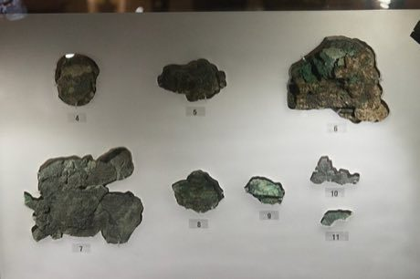

# Antikythera Gear Train

*Also known as: Μηχανισμός των Αντικυθήρων*

**Encyclopedia ID 397** (permanent) · https://bpupadhyaya.github.io/world-heritage-games-site/games/397-antikythera-gear-train/

*Photo: Gts-tg, [CC BY-SA 4.0](https://creativecommons.org/licenses/by-sa/4.0/), [source on Wikimedia Commons](https://commons.wikimedia.org/wiki/File:Antikythera_mechanism_clockface,_1st-2nd_century_BC,_Greece_(model).jpg)*

Arrange cogs of different tooth counts on pins so that turning the crank moves dials to the right sun, moon and calendar positions.

## Heritage note

Part of the living heritage of Greece.

## Origins

Usually placed in the era of Modern Heritage (1800 to today), although its exact origins are uncertain, within the cultural world of Mediterranean.

## Facts

- **Where:** Greece
- **Type:** Puzzles and mind games
- **Family:** Puzzle and dexterity toys
- **Era:** [Modern Heritage](../../eras/modern/index.md) (uncertain)
- **Cradle:** [Mediterranean](../../cradles/mediterranean/index.md)
- **Region:** Europe

## Related entries

- [Euclid's Ruler and Compass](../../games/396-euclids-ruler-and-compass/index.md)
- [Castells](../../games/119-castells/index.md)
- [Flag Tossing](../../games/395-flag-tossing/index.md)
- [Portolan Chart Navigator](../../games/503-portolan-chart-navigator/index.md)
- [Ghadames Rooftop Maze](../../games/1291-ghadames-rooftop-maze/index.md)
- [Kingyo-sukui](../../games/3-kingyo-sukui/index.md)

## Sources

- <https://commons.wikimedia.org/wiki/File:Antikythera_mechanism_clockface,_1st-2nd_century_BC,_Greece_(model).jpg>
