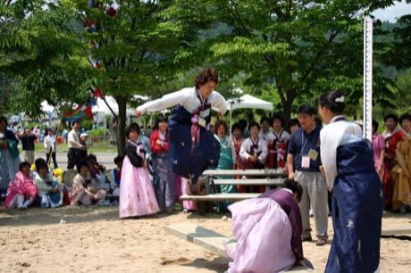

# Neolttwigi

*Also known as: 널뛰기 · seesaw jumping*

**Encyclopedia ID 4** (permanent) · https://bpupadhyaya.github.io/world-heritage-games-site/games/4-neolttwigi/

*Photo: Robert at Picasa, [CC BY 3.0](https://creativecommons.org/licenses/by/3.0/), [source on Wikimedia Commons](https://commons.wikimedia.org/wiki/File:Korea-Andong-Dano_Festival-Seesawing-02.jpg)*

Two players stand on opposite ends of a board and alternate jumping, launching each other higher; the goal is the highest, best-timed jumps and stylish landings.

## Heritage note

Part of the living heritage of South Korea.

## Origins

Usually placed in the era of Modern Heritage (1800 to today), although its exact origins are uncertain, within the cultural world of Japan and Korea.

## Facts

- **Where:** South Korea
- **Type:** Street and playground games
- **Era:** [Modern Heritage](../../eras/modern/index.md) (uncertain)
- **Cradle:** [Japan and Korea](../../cradles/japan-korea/index.md)
- **Region:** East and Southeast Asia

## Related entries

- [Hangul syllable blocks](../../games/364-hangul-syllable-blocks/index.md)
- [Haenyeo Breath Dive](../../games/1459-haenyeo-breath-dive/index.md)
- [Jegichagi](../../games/1082-jegichagi/index.md)
- [Tuho](../../games/1089-tuho/index.md)
- [Kingyo-sukui](../../games/3-kingyo-sukui/index.md)
- [Daruma Otoshi](../../games/63-daruma-otoshi/index.md)

## Sources

- <https://commons.wikimedia.org/wiki/File:Korea-Andong-Dano_Festival-Seesawing-02.jpg>
