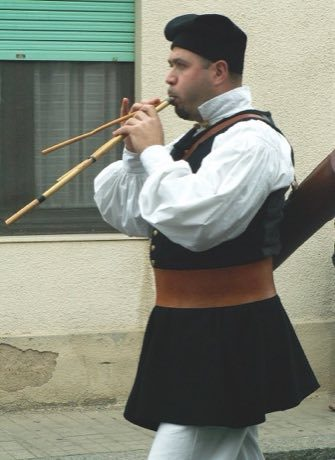

# Launeddas Triple Pipe

*Launeddas*

**Encyclopedia ID 400** (permanent) · https://equalinformation.com/world-heritage-games-site/games/400-launeddas-triple-pipe/

*Photo: Maurizio Pia, [CC BY 2.5](https://creativecommons.org/licenses/by/2.5/), [source on Wikimedia Commons](https://commons.wikimedia.org/wiki/File:Launeddas_Player.jpg)*

Hold a continuous drone while switching fingered melody notes; the circular-breathing meter must never run out as the tune ornaments loop.

## Heritage note

Part of the living heritage of Italy.

## Origins

A living tradition passed from person to person; it is not tied to a single dated origin. It belongs to the cultural world of Mediterranean.

## Facts

- **Where:** Italy
- **Type:** Musical instruments
- **Family:** Wind instruments
- **Era:** [Living Traditions](../../eras/living/index.md)
- **Cradle:** [Mediterranean](../../cradles/mediterranean/index.md)
- **Region:** Europe

## Related entries

- [Khene](../../games/145-khene/index.md)
- [Mijwiz Double Clarinet](../../games/221-mijwiz-double-clarinet/index.md)
- [Mudhif reed-arch house](../../games/230-mudhif-reed-arch-house/index.md)
- [Lusheng](../../games/337-lusheng/index.md)
- [Rubboard zydeco rhythm](../../games/437-rubboard-zydeco-rhythm/index.md)
- [Cuneiform Clay Tablet Scribe](../../games/1260-cuneiform-clay-tablet-scribe/index.md)

## Sources

- <https://commons.wikimedia.org/wiki/File:Launeddas_Player.jpg>
