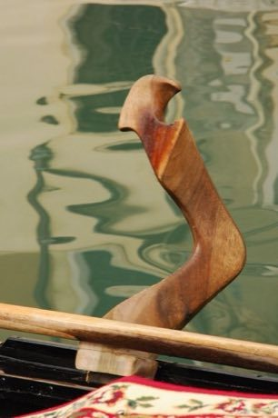

# Gondola Rowing

*Voga alla veneta*

**Encyclopedia ID 401** (permanent) · https://equalinformation.com/world-heritage-games-site/games/401-gondola-rowing/

*Photo: Sbisolo, [CC BY-SA 3.0](https://creativecommons.org/licenses/by-sa/3.0/), [source on Wikimedia Commons](https://commons.wikimedia.org/wiki/File:Forcola_di_gondola_veneziana.jpg)*

Stand and row with a single oar on a carved forcola, steering through narrow canals and tight corners without bumping the walls.

## Heritage note

Part of the living heritage of Italy.

## Origins

Usually placed in the era of Modern Heritage (1800 to today), although its exact origins are uncertain, within the cultural world of Mediterranean.

## Facts

- **Where:** Italy
- **Type:** Dexterity and skill games
- **Family:** Winter sports
- **Era:** [Modern Heritage](../../eras/modern/index.md) (uncertain)
- **Cradle:** [Mediterranean](../../cradles/mediterranean/index.md)
- **Region:** Europe

## Related entries

- [Crossbow Target Match](../../games/1367-crossbow-target-match/index.md)
- [Ring Tilting](../../games/65-ring-tilting/index.md)
- [Chinlone](../../games/16-chinlone/index.md)
- [Pinata swing](../../games/61-pinata-swing/index.md)
- [Yukigassen Snow Fort](../../games/71-yukigassen-snow-fort/index.md)
- [Bagatelle](../../games/72-bagatelle/index.md)

## Sources

- <https://commons.wikimedia.org/wiki/File:Forcola_di_gondola_veneziana.jpg>
