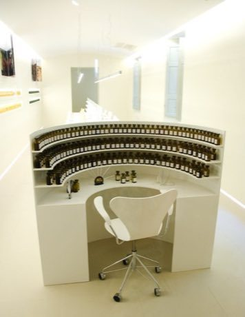

# Perfumer's Organ

*Orgue à parfums (Grasse)*

**Encyclopedia ID 402** (permanent) · https://equalinformation.com/world-heritage-games-site/games/402-perfumers-organ/

*Photo: Taco Ekkel, [CC BY-SA 2.0](https://creativecommons.org/licenses/by-sa/2.0/), [source on Wikimedia Commons](https://commons.wikimedia.org/wiki/File:Perfume_Organ,_Grasse.jpg)*

Mix top, heart and base notes from a curved shelf of scent bottles to match a target fragrance profile within a budget of drops.

## Heritage note

A tradition shared by communities in many places.

## Origins

A living tradition passed from person to person; it is not tied to a single dated origin.

## Facts

- **Where:** Shared across many places
- **Type:** Crafts and making
- **Era:** [Living Traditions](../../eras/living/index.md)
- **Cradle:** [Shared across the world](../../cradles/worldwide/index.md)
- **Region:** Europe

## Sources

- <https://commons.wikimedia.org/wiki/File:Perfume_Organ,_Grasse.jpg>
