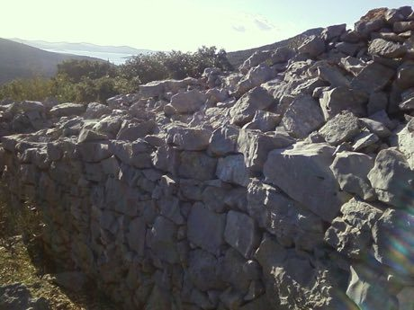

# Dry Stone Wall Builder

*Suhozid / pared de piedra seca / muri a secco*

**Encyclopedia ID 404** (permanent) · https://bpupadhyaya.github.io/world-heritage-games-site/games/404-dry-stone-wall-builder/

*Photo: antonioskara, [CC BY-SA 3.0](https://creativecommons.org/licenses/by-sa/3.0/), [source on Wikimedia Commons](https://commons.wikimedia.org/wiki/File:Dry_stone_wall_-_Bencic,_Kraj,_Pasman_-_panoramio.jpg)*

Pick irregular stones from a pile and fit them into a wall with no mortar, keeping courses staggered and stable under a gravity simulation.

## Heritage note

Part of the living heritage of Croatia, Spain, Italy.

## Origins

A living tradition passed from person to person; it is not tied to a single dated origin. It belongs to the cultural world of Mediterranean.

## Facts

- **Where:** Croatia, Spain, Italy, Greece, Malta
- **Type:** Crafts and making
- **Era:** [Living Traditions](../../eras/living/index.md)
- **Cradle:** [Mediterranean](../../cradles/mediterranean/index.md)
- **Region:** Europe

## Related entries

- [Glassblowing](../../games/121-glassblowing/index.md)
- [Txalaparta Duet](../../games/390-txalaparta-duet/index.md)
- [Sicilian Cart Painting](../../games/399-sicilian-cart-painting/index.md)
- [Launeddas Triple Pipe](../../games/400-launeddas-triple-pipe/index.md)
- [Steal the Flag](../../games/474-steal-the-flag/index.md)
- [Tamburello](../../games/489-tamburello/index.md)

## Sources

- <https://commons.wikimedia.org/wiki/File:Dry_stone_wall_-_Bencic,_Kraj,_Pasman_-_panoramio.jpg>
