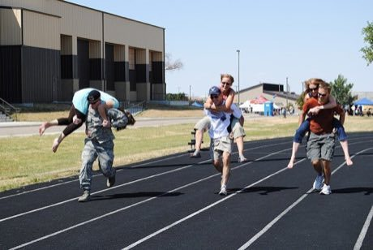

# Partner-Carry Obstacle Race

*Eukonkanto*

**Encyclopedia ID 406** (permanent) · https://equalinformation.com/world-heritage-games-site/games/406-partner-carry-obstacle-race/

*Photo: U.S. Air Force photo by Cortney Paxton, [Public domain](https://creativecommons.org/publicdomain/mark/1.0/), [source on Wikimedia Commons](https://commons.wikimedia.org/wiki/File:Malmstrom_wife_carry.JPG)*

Run a 253 m obstacle track with a partner on your back over hurdles and a water pit.

## Heritage note

Part of the living heritage of Finland.

## Origins

Usually placed in the era of Age of Contact and Craft (about 1500 to 1800), although its exact origins are uncertain, within the cultural world of Northern and Eastern Europe.

## Facts

- **Where:** Finland
- **Type:** Racing
- **Era:** [Age of Contact and Craft](../../eras/contact/index.md) (uncertain)
- **Cradle:** [Northern and Eastern Europe](../../cradles/north-east-europe/index.md)
- **Region:** Europe

## Related entries

- [Finnish pin toss](../../games/49-finnish-pin-toss/index.md)
- [Kicksled Race](../../games/407-kicksled-race/index.md)
- [Kyykka](../../games/715-kyykka/index.md)
- [Gorodki](../../games/13-gorodki/index.md)
- [Oina](../../games/376-oina/index.md)
- [Letter Categories](../../games/472-letter-categories/index.md)

## Sources

- <https://commons.wikimedia.org/wiki/File:Malmstrom_wife_carry.JPG>
