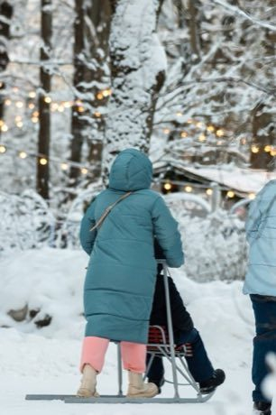

# Kicksled Race

*Spark / Potkukelkka*

**Encyclopedia ID 407** (permanent) · https://bpupadhyaya.github.io/world-heritage-games-site/games/407-kicksled-race/

*Photo: Горбунова М.С., [CC BY-SA 4.0](https://creativecommons.org/licenses/by-sa/4.0/), [source on Wikimedia Commons](https://commons.wikimedia.org/wiki/File:Kicksled_at_the_Yelagin_Park.jpg)*

Stand on the runners of a chair-fronted kicksled and kick off the snow; time kicks, steer and coast through a snowy town course or frozen lake race.

## Heritage note

Part of the living heritage of Finland, Sweden, Norway.

## Origins

Usually placed in the era of Age of Contact and Craft (about 1500 to 1800), although its exact origins are uncertain, within the cultural world of Northern and Eastern Europe.

## Facts

- **Where:** Finland, Sweden, Norway
- **Type:** Racing
- **Family:** Winter sports
- **Era:** [Age of Contact and Craft](../../eras/contact/index.md) (uncertain)
- **Cradle:** [Northern and Eastern Europe](../../cradles/north-east-europe/index.md)
- **Region:** Europe

## Related entries

- [Finnish pin toss](../../games/49-finnish-pin-toss/index.md)
- [Sled dog race](../../games/62-sled-dog-race/index.md)
- [Candlepin bowling](../../games/444-candlepin-bowling/index.md)
- [Luge and toboggan run](../../games/482-luge-and-toboggan-run/index.md)
- [Varpa](../../games/1396-varpa/index.md)
- [Frisian Road Bowling](../../games/1441-frisian-road-bowling/index.md)

## Sources

- <https://commons.wikimedia.org/wiki/File:Kicksled_at_the_Yelagin_Park.jpg>
