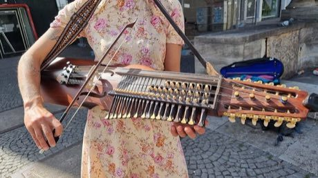

# Nyckelharpa

*Also known as: key fiddle*

**Encyclopedia ID 408** (permanent) · https://bpupadhyaya.github.io/world-heritage-games-site/games/408-nyckelharpa/

*Photo: Bernd Schwabe in Hannover, [CC BY-SA 4.0](https://creativecommons.org/licenses/by-sa/4.0/), [source on Wikimedia Commons](https://commons.wikimedia.org/wiki/File:2022-07-28_Nyckelharpa-Spielerin_in_der_Schillerstra%C3%9Fe_Ecke_Rosenstra%C3%9Fe_in_Hannover.jpg)*

Play melodies by pressing wooden keys under the strings while bowing a drone; follow falling notes of folk tunes.

## Heritage note

Part of the living heritage of Sweden.

## Origins

Usually placed in the era of Classical Worlds (about 1000 BCE to 500 CE), although its exact origins are uncertain, within the cultural world of Northern and Eastern Europe.

## Facts

- **Where:** Sweden
- **Type:** Musical instruments
- **Family:** String instruments
- **Era:** [Classical Worlds](../../eras/classical/index.md) (uncertain)
- **Cradle:** [Northern and Eastern Europe](../../cradles/north-east-europe/index.md)
- **Region:** Europe

## Related entries

- [String Marionette Theatre](../../games/68-string-marionette-theatre/index.md)
- [Kanklės](../../games/136-kankles/index.md)
- [Kantele](../../games/152-kantele/index.md)
- [Langeleik](../../games/1322-langeleik/index.md)
- [Morin khuur](../../games/34-morin-khuur/index.md)
- [Kathputli string puppets](../../games/79-kathputli-string-puppets/index.md)

## Sources

- <https://commons.wikimedia.org/wiki/File:2022-07-28_Nyckelharpa-Spielerin_in_der_Schillerstra%C3%9Fe_Ecke_Rosenstra%C3%9Fe_in_Hannover.jpg>
