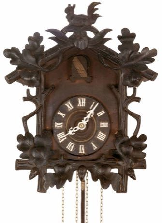

# Black Forest Cuckoo Clock Workshop

*Also known as: Kuckucksuhr*

**Encyclopedia ID 409** (permanent) · https://bpupadhyaya.github.io/world-heritage-games-site/games/409-black-forest-cuckoo-clock-workshop/

*Photo: -- da didi, [CC BY-SA 3.0](https://creativecommons.org/licenses/by-sa/3.0/), [source on Wikimedia Commons](https://commons.wikimedia.org/wiki/File:Kuckucksuhr.JPG)*

Assemble the gears, weights, bellows and carved case of a cuckoo clock in the correct order, then tune the pendulum and watch the cuckoo call on the hour.

## Heritage note

Part of the living heritage of Germany.

## Origins

A living tradition passed from person to person; it is not tied to a single dated origin. It belongs to the cultural world of Northern and Eastern Europe.

## Facts

- **Where:** Germany
- **Type:** Crafts and making
- **Family:** Drums and percussion
- **Era:** [Living Traditions](../../eras/living/index.md)
- **Cradle:** [Northern and Eastern Europe](../../cradles/north-east-europe/index.md)
- **Region:** Europe

## Related entries

- [Talking drum](../../games/33-talking-drum/index.md)
- [Tabla Bol Rhythm](../../games/35-tabla-bol-rhythm/index.md)
- [Marimba](../../games/52-marimba/index.md)
- [Shekere gourd rattle](../../games/125-shekere-gourd-rattle/index.md)
- [Madal drum](../../games/147-madal-drum/index.md)
- [Calabash Water Drum](../../games/180-calabash-water-drum/index.md)

## Sources

- <https://commons.wikimedia.org/wiki/File:Kuckucksuhr.JPG>
