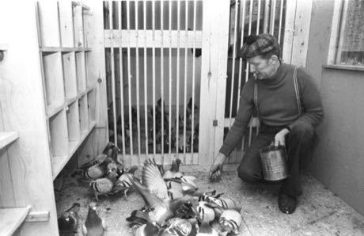

# Racing Pigeon Loft

*Also known as: Brieftaubensport · Colombophilie*

**Encyclopedia ID 411** (permanent) · https://bpupadhyaya.github.io/world-heritage-games-site/games/411-racing-pigeon-loft/

*Photo: Reinhard Kaufhold, CC BY-SA 3.0 de, [source on Wikimedia Commons](https://commons.wikimedia.org/wiki/File:Bundesarchiv_Bild_183-W0212-034,_Sporttaubenz%C3%BCchter.jpg)*

Breed and train a loft of homing pigeons, choose which birds to enter, and judge weather and wind to win distance races.

## Heritage note

Part of the living heritage of Belgium, Netherlands, United Kingdom. Animals are partners in this tradition; good care and local rules always come first.

## Origins

Usually placed in the era of Crossroads and Golden Ages (about 500 to 1500), although its exact origins are uncertain, within the cultural world of Celtic and Atlantic Europe.

## Facts

- **Where:** Belgium, Netherlands, United Kingdom
- **Type:** Board and table games
- **Era:** [Crossroads and Golden Ages](../../eras/crossroads/index.md) (uncertain)
- **Cradle:** [Celtic and Atlantic Europe](../../cradles/celtic-atlantic/index.md)
- **Region:** Europe

## Related entries

- [Croquet](../../games/81-croquet/index.md)
- [Highland Bagpipe Chanter and Drone](../../games/510-highland-bagpipe-chanter-and-drone/index.md)
- [Fox and Geese](../../games/4615-fox-and-geese/index.md)
- [Dutch draughts](../../games/970-dutch-draughts/index.md)
- [Pub dominoes](../../games/1183-pub-dominoes/index.md)
- [Hare and Hounds](../../games/4647-hare-and-hounds/index.md)

## Sources

- <https://commons.wikimedia.org/wiki/File:Bundesarchiv_Bild_183-W0212-034,_Sporttaubenz%C3%BCchter.jpg>
