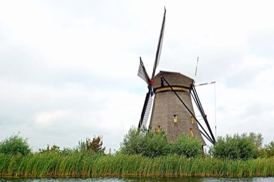

# Polder Windmill Keeper

*Molen / Poldermolen*

**Encyclopedia ID 412** (permanent) · https://bpupadhyaya.github.io/world-heritage-games-site/games/412-polder-windmill-keeper/

*Photo: Dennis G. Jarvis, [CC BY-SA 2.0](https://creativecommons.org/licenses/by-sa/2.0/), [source on Wikimedia Commons](https://commons.wikimedia.org/wiki/File:Netherlands-4760_-_Ground_Sail_Windmill_(12321407854).jpg)*

Turn the cap into the wind, set the sail cloths and brake to pump water out of the polder before it floods.

## Heritage note

Part of the living heritage of Netherlands. Some forms of this practice carry deep meaning for the communities who keep it; here we describe the play and the craft only, with respect for its roots.

## Origins

Usually placed in the era of River Valleys and First Cities (about 3000 to 1000 BCE), although its exact origins are uncertain, within the cultural world of Celtic and Atlantic Europe.

## Facts

- **Where:** Netherlands
- **Type:** Puzzles and mind games
- **Family:** Puzzle and dexterity toys
- **Era:** [River Valleys and First Cities](../../eras/river-valleys/index.md) (uncertain)
- **Cradle:** [Celtic and Atlantic Europe](../../cradles/celtic-atlantic/index.md)
- **Region:** Europe

## Related entries

- [Windmill Miller](../../games/507-windmill-miller/index.md)
- [Sjoelen](../../games/9-sjoelen/index.md)
- [Goguryeo Mural Restoration](../../games/1454-goguryeo-mural-restoration/index.md)
- [Disc-flip](../../games/8-disc-flip/index.md)
- [Shove ha'penny](../../games/54-shove-hapenny/index.md)
- [Change Ringing](../../games/1443-change-ringing/index.md)

## Sources

- <https://commons.wikimedia.org/wiki/File:Netherlands-4760_-_Ground_Sail_Windmill_(12321407854).jpg>
