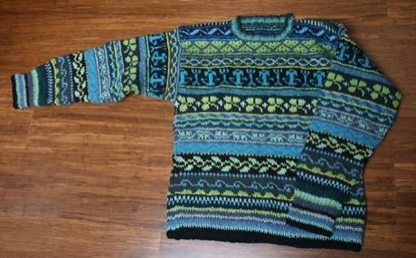

# Nordic Colourwork Knitting

*Also known as: Fair Isle · Selbu · Lopapeysa*

**Encyclopedia ID 413** (permanent) · https://bpupadhyaya.github.io/world-heritage-games-site/games/413-nordic-colourwork-knitting/

*Photo: Lisa Dusseault from USA, [CC BY 2.0](https://creativecommons.org/licenses/by/2.0/), [source on Wikimedia Commons](https://commons.wikimedia.org/wiki/File:Oceans_and_trees_Fair_Isle_pullover.jpg)*

Pick two or three yarn colours and fill a chart row by row to knit star, snowflake and band motifs that match a target jumper.

## Heritage note

Part of the living heritage of United Kingdom, Norway, Iceland.

## Origins

A living tradition passed from person to person; it is not tied to a single dated origin. It belongs to the cultural world of Celtic and Atlantic Europe.

## Facts

- **Where:** United Kingdom, Norway, Iceland
- **Type:** Crafts and making
- **Family:** Textile and weaving crafts
- **Era:** [Living Traditions](../../eras/living/index.md)
- **Cradle:** [Celtic and Atlantic Europe](../../cradles/celtic-atlantic/index.md)
- **Region:** Europe

## Related entries

- [Celtic knot weave](../../games/25-celtic-knot-weave/index.md)
- [Ribbon Pole Weave](../../games/419-ribbon-pole-weave/index.md)
- [Tartan Sett Weaving](../../games/505-tartan-sett-weaving/index.md)
- [Bobbin lace making](../../games/108-bobbin-lace-making/index.md)
- [Kente strip weaving](../../games/22-kente-strip-weaving/index.md)
- [Sashiko Stitch Patterns](../../games/27-sashiko-stitch-patterns/index.md)

## Sources

- <https://commons.wikimedia.org/wiki/File:Oceans_and_trees_Fair_Isle_pullover.jpg>
