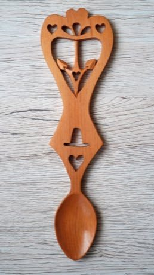

# Welsh Love Spoon Carving

*Llwy garu*

**Encyclopedia ID 414** (permanent) · https://bpupadhyaya.github.io/world-heritage-games-site/games/414-welsh-love-spoon-carving/

*Photo: Kmtextor, [CC BY-SA 4.0](https://creativecommons.org/licenses/by-sa/4.0/), [source on Wikimedia Commons](https://commons.wikimedia.org/wiki/File:Welsh_love_spoon.jpg)*

Carve a spoon from a block, choosing hearts, keys, wheels and chain links for the handle by cutting along guides.

## Heritage note

Part of the living heritage of United Kingdom.

## Origins

A living tradition passed from person to person; it is not tied to a single dated origin. It belongs to the cultural world of Celtic and Atlantic Europe.

## Facts

- **Where:** United Kingdom
- **Type:** Crafts and making
- **Family:** Pottery, wood and metal crafts
- **Era:** [Living Traditions](../../eras/living/index.md)
- **Cradle:** [Celtic and Atlantic Europe](../../cradles/celtic-atlantic/index.md)
- **Region:** Europe

## Related entries

- [Blacksmith's Forge](../../games/506-blacksmiths-forge/index.md)
- [Zellij tile mosaic](../../games/21-zellij-tile-mosaic/index.md)
- [Swahili carved door](../../games/90-swahili-carved-door/index.md)
- [Thai fruit and vegetable carving](../../games/114-thai-fruit-and-vegetable-carving/index.md)
- [Glassblowing](../../games/121-glassblowing/index.md)
- [Azulejo tile painting](../../games/122-azulejo-tile-painting/index.md)

## Sources

- <https://commons.wikimedia.org/wiki/File:Welsh_love_spoon.jpg>
