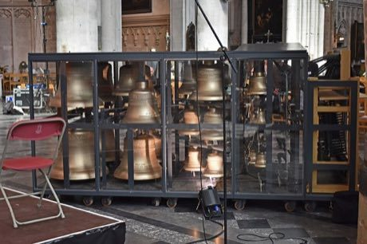

# Carillon

*Also known as: Beiaard*

**Encyclopedia ID 418** (permanent) · https://bpupadhyaya.github.io/world-heritage-games-site/games/418-carillon/

*Photo: Ymblanter, [CC BY-SA 4.0](https://creativecommons.org/licenses/by-sa/4.0/), [source on Wikimedia Commons](https://commons.wikimedia.org/wiki/File:Mechelen_Sint-Romboutskathedraal_Carillon_2.jpg)*

Strike the wooden baton keyboard with fists and foot pedals to ring bronze bells in a tower and play melodies.

## Heritage note

Part of the living heritage of Belgium, Netherlands. Some forms of this practice carry deep meaning for the communities who keep it; here we describe the play and the craft only, with respect for its roots.

## Origins

A living tradition passed from person to person; it is not tied to a single dated origin. It belongs to the cultural world of Celtic and Atlantic Europe.

## Facts

- **Where:** Belgium, Netherlands
- **Type:** Musical instruments
- **Family:** Drums and percussion
- **Era:** [Living Traditions](../../eras/living/index.md)
- **Cradle:** [Celtic and Atlantic Europe](../../cradles/celtic-atlantic/index.md)
- **Region:** Europe

## Related entries

- [Talking drum](../../games/33-talking-drum/index.md)
- [Marimba](../../games/52-marimba/index.md)
- [Calabash Water Drum](../../games/180-calabash-water-drum/index.md)
- [Amadinda and embaire](../../games/185-amadinda-and-embaire/index.md)
- [Tombak goblet drum rhythms](../../games/233-tombak-goblet-drum-rhythms/index.md)
- [Dhol drum rhythm](../../games/263-dhol-drum-rhythm/index.md)

## Sources

- <https://commons.wikimedia.org/wiki/File:Mechelen_Sint-Romboutskathedraal_Carillon_2.jpg>
