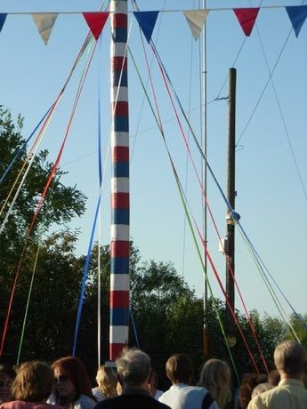

# Ribbon Pole Weave

*Maypole dance / Lintdans*

**Encyclopedia ID 419** (permanent) · https://equalinformation.com/world-heritage-games-site/games/419-ribbon-pole-weave/

*Photo: David Luther Thomas, [CC BY-SA 2.0](https://creativecommons.org/licenses/by-sa/2.0/), [source on Wikimedia Commons](https://commons.wikimedia.org/wiki/File:Maypole_ribbons_-_geograph.org.uk_-_420383.jpg)*

Dancers circle a pole in alternating directions; choose the over-under steps to plait a perfect ribbon pattern down the pole.

## Heritage note

Part of the living heritage of United Kingdom, Spain.

## Origins

A living tradition passed from person to person; it is not tied to a single dated origin. It belongs to the cultural world of Celtic and Atlantic Europe.

## Facts

- **Where:** United Kingdom, Spain
- **Type:** Dances
- **Family:** Textile and weaving crafts
- **Era:** [Living Traditions](../../eras/living/index.md)
- **Cradle:** [Celtic and Atlantic Europe](../../cradles/celtic-atlantic/index.md)
- **Region:** Europe

## Related entries

- [Celtic knot weave](../../games/25-celtic-knot-weave/index.md)
- [Nordic Colourwork Knitting](../../games/413-nordic-colourwork-knitting/index.md)
- [Tartan Sett Weaving](../../games/505-tartan-sett-weaving/index.md)
- [Bobbin lace making](../../games/108-bobbin-lace-making/index.md)
- [Kente strip weaving](../../games/22-kente-strip-weaving/index.md)
- [Sashiko Stitch Patterns](../../games/27-sashiko-stitch-patterns/index.md)

## Sources

- <https://commons.wikimedia.org/wiki/File:Maypole_ribbons_-_geograph.org.uk_-_420383.jpg>
