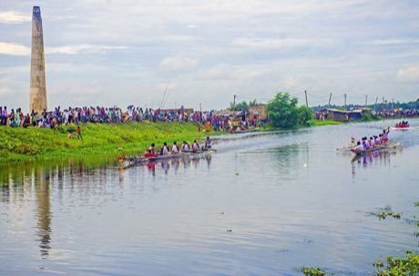

# Nouka Baich

*নৌকা বাইচ · village boat race*

**Encyclopedia ID 42** (permanent) · https://bpupadhyaya.github.io/world-heritage-games-site/games/42-nouka-baich/

*Photo: Rangan Datta Wiki, [CC BY-SA 4.0](https://creativecommons.org/licenses/by-sa/4.0/), [source on Wikimedia Commons](https://commons.wikimedia.org/wiki/File:Boat_Race_(Nouka_Baich)_at_Thakrun_Khal,_near_Canning_09.jpg)*

Long boats with a crew of paddlers race down a river while a lead singer calls the rhythm and the crowd cheers from the banks.

## Heritage note

Part of the living heritage of Bangladesh, India.

## Origins

Usually placed in the era of Age of Contact and Craft (about 1500 to 1800), although its exact origins are uncertain, within the cultural world of South Asia.

## Facts

- **Where:** Bangladesh, India
- **Type:** Racing
- **Family:** Water sports
- **Era:** [Age of Contact and Craft](../../eras/contact/index.md) (uncertain)
- **Cradle:** [South Asia](../../cradles/south-asia/index.md)
- **Region:** South and Central Asia

## Related entries

- [Shikara paddle race](../../games/265-shikara-paddle-race/index.md)
- [Pirogue coastal canoe race](../../games/56-pirogue-coastal-canoe-race/index.md)
- [Nile Felucca Sailing](../../games/216-nile-felucca-sailing/index.md)
- [Hanetsuki](../../games/347-hanetsuki/index.md)
- [Venetian lagoon regatta](../../games/486-venetian-lagoon-regatta/index.md)
- [Ngalawa outrigger sailing](../../games/1259-ngalawa-outrigger-sailing/index.md)

## Sources

- <https://commons.wikimedia.org/wiki/File:Boat_Race_(Nouka_Baich)_at_Thakrun_Khal,_near_Canning_09.jpg>
