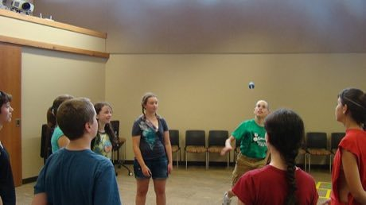

# Peteca

*Also known as: hand shuttlecock*

**Encyclopedia ID 421** (permanent) · https://bpupadhyaya.github.io/world-heritage-games-site/games/421-peteca/

*Photo: Bonner Springs Library, [CC BY 2.0](https://creativecommons.org/licenses/by/2.0/), [source on Wikimedia Commons](https://commons.wikimedia.org/wiki/File:Peteca_(5812874643).jpg)*

Players slap a feathered, weighted shuttle with the palm over a high net, rallying like volleyball with at most a few touches per side.

## Heritage note

Part of the living heritage of Brazil.

## Origins

Usually placed in the era of Modern Heritage (1800 to today), although its exact origins are uncertain, within the cultural world of The Americas: Andes and South America.

## Facts

- **Where:** Brazil
- **Type:** Dexterity and skill games
- **Family:** Kicking and football games
- **Era:** [Modern Heritage](../../eras/modern/index.md) (uncertain)
- **Cradle:** [The Americas: Andes and South America](../../cradles/andes-south-america/index.md)
- **Region:** Americas

## Play it

[Web preview](https://bpupadhyaya.github.io/) · [Google Play](https://play.google.com/store/apps/details?id=com.equalinformation.arcforge.shell) · [App Store](https://apps.apple.com/us/app/arcforge-world-heritage-games/id6813746442)

## Related entries

- [Jianzi](../../games/1-jianzi/index.md)
- [Nohejbal](../../games/378-nohejbal/index.md)
- [Sepak takraw](../../games/802-sepak-takraw/index.md)
- [Chapteh shuttlecock](../../games/1066-chapteh-shuttlecock/index.md)
- [Traditional football](../../games/10068-traditional-football/index.md)
- [American football](../../games/22320-american-football/index.md)

## Sources

- <https://commons.wikimedia.org/wiki/File:Peteca_(5812874643).jpg>
