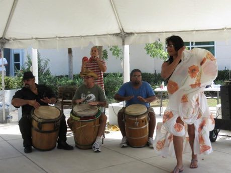

# Bomba

*Bomba puertorriqueña · barrel drums and dancer*

**Encyclopedia ID 425** (permanent) · https://equalinformation.com/world-heritage-games-site/games/425-bomba/

*Photo: U.S. Fish and Wildlife Service Southeast Region, [Public domain](https://creativecommons.org/publicdomain/mark/1.0/), [source on Wikimedia Commons](https://commons.wikimedia.org/wiki/File:Puerto_Rican_Bomba._(Refuge_Week_Activity_2012)_(8213578853).jpg)*

A dancer 'challenges' the lead drummer with a step and the drummer answers.

## Heritage note

A tradition shared by communities in many places.

## Origins

A living tradition passed from person to person; it is not tied to a single dated origin.

## Facts

- **Where:** Shared across many places
- **Type:** Dances
- **Family:** Drums and percussion
- **Era:** [Living Traditions](../../eras/living/index.md)
- **Cradle:** [Shared across the world](../../cradles/worldwide/index.md)
- **Region:** Americas

## Related entries

- [Talking drum](../../games/33-talking-drum/index.md)
- [Calabash Water Drum](../../games/180-calabash-water-drum/index.md)
- [Amadinda and embaire](../../games/185-amadinda-and-embaire/index.md)
- [Tombak goblet drum rhythms](../../games/233-tombak-goblet-drum-rhythms/index.md)
- [Dhol drum rhythm](../../games/263-dhol-drum-rhythm/index.md)
- [Ranat ek](../../games/305-ranat-ek/index.md)

## Sources

- <https://commons.wikimedia.org/wiki/File:Puerto_Rican_Bomba._(Refuge_Week_Activity_2012)_(8213578853).jpg>
