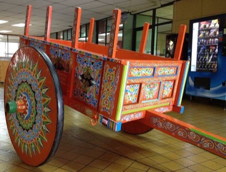

# Costa Rican painted oxcart

*Also known as: Carreta tipica (Sarchi)*

**Encyclopedia ID 427** (permanent) · https://bpupadhyaya.github.io/world-heritage-games-site/games/427-costa-rican-painted-oxcart/

*Photo: Axxis10, [CC BY-SA 3.0](https://creativecommons.org/licenses/by-sa/3.0/), [source on Wikimedia Commons](https://commons.wikimedia.org/wiki/File:Carreta_tipica_Sarchi_(1).JPG)*

Paint the wheel's radial sunburst, the side panels and the yoke with the traditional geometric and flower patterns, matching colour and symmetry rules.

## Heritage note

Part of the living heritage of Costa Rica.

## Origins

A living tradition passed from person to person; it is not tied to a single dated origin. It belongs to the cultural world of The Americas: Mesoamerica.

## Facts

- **Where:** Costa Rica
- **Type:** Crafts and making
- **Family:** Paper, ink and painting crafts
- **Era:** [Living Traditions](../../eras/living/index.md)
- **Cradle:** [The Americas: Mesoamerica](../../cradles/meso-america/index.md)
- **Region:** Americas

## Play it

[Try a 90-second preview in your browser](https://bpupadhyaya.github.io/games-site/games/costa-rican-painted-oxcart/play/) · [Google Play](https://play.google.com/store/apps/details?id=com.equalinformation.arcforge.shell) · [App Store](https://apps.apple.com/us/app/arcforge-world-heritage-games/id6813746442)

## Related entries

- [Alebrije painting](../../games/92-alebrije-painting/index.md)
- [Pollera and Tembleques](../../games/1480-pollera-and-tembleques/index.md)
- [Giant Barriletes](../../games/1486-giant-barriletes/index.md)
- [Ebru paper marbling](../../games/20-ebru-paper-marbling/index.md)
- [Ndebele geometric wall painting](../../games/23-ndebele-geometric-wall-painting/index.md)
- [Chinese knotting](../../games/26-chinese-knotting/index.md)

## Sources

- <https://commons.wikimedia.org/wiki/File:Carreta_tipica_Sarchi_(1).JPG>
