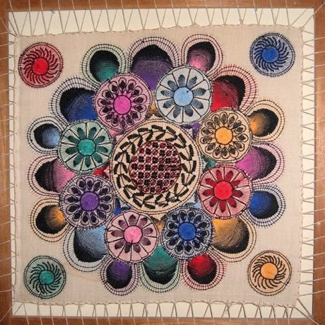

# Nanduti

*Nanduti · spider-web lace*

**Encyclopedia ID 428** (permanent) · https://bpupadhyaya.github.io/world-heritage-games-site/games/428-nanduti/

*Photo: Trey Jones, [Public domain](https://creativecommons.org/publicdomain/mark/1.0/), [source on Wikimedia Commons](https://commons.wikimedia.org/wiki/File:Nanduti_lace.jpg)*

Stitch radial threads on a frame and fill sunburst and flower motifs with coloured thread following a pattern, like a simple weaving puzzle.

## Heritage note

Part of the living heritage of Paraguay.

## Origins

A living tradition passed from person to person; it is not tied to a single dated origin. It belongs to the cultural world of The Americas: Andes and South America.

## Facts

- **Where:** Paraguay
- **Type:** Crafts and making
- **Family:** Textile and weaving crafts
- **Era:** [Living Traditions](../../eras/living/index.md)
- **Cradle:** [The Americas: Andes and South America](../../cradles/andes-south-america/index.md)
- **Region:** Americas

## Related entries

- [Toquilla straw hat weaving](../../games/93-toquilla-straw-hat-weaving/index.md)
- [Kente strip weaving](../../games/22-kente-strip-weaving/index.md)
- [Celtic knot weave](../../games/25-celtic-knot-weave/index.md)
- [Sashiko Stitch Patterns](../../games/27-sashiko-stitch-patterns/index.md)
- [Adire indigo resist dyeing](../../games/87-adire-indigo-resist-dyeing/index.md)
- [Agaseke basket weaving](../../games/89-agaseke-basket-weaving/index.md)

## Sources

- <https://commons.wikimedia.org/wiki/File:Nanduti_lace.jpg>
