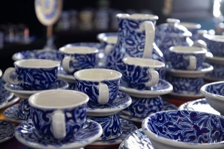

# Talavera tile painting

*Also known as: Talavera poblana*

**Encyclopedia ID 429** (permanent) · https://bpupadhyaya.github.io/world-heritage-games-site/games/429-talavera-tile-painting/

*Photo: Rick-Al-Fo, [CC BY-SA 4.0](https://creativecommons.org/licenses/by-sa/4.0/), [source on Wikimedia Commons](https://commons.wikimedia.org/wiki/File:Talavera_poblana.jpg)*

Paint a blue-and-white tile or plate pattern in the traditional Talavera style by filling outlines and repeating motifs, then fire and view the finished piece.

## Heritage note

Part of the living heritage of Mexico.

## Origins

A living tradition passed from person to person; it is not tied to a single dated origin. It belongs to the cultural world of The Americas: Mesoamerica.

## Facts

- **Where:** Mexico
- **Type:** Crafts and making
- **Family:** Pottery, wood and metal crafts
- **Era:** [Living Traditions](../../eras/living/index.md)
- **Cradle:** [The Americas: Mesoamerica](../../cradles/meso-america/index.md)
- **Region:** Americas

## Related entries

- [Chorreador](../../games/1446-chorreador/index.md)
- [Zellij tile mosaic](../../games/21-zellij-tile-mosaic/index.md)
- [Swahili carved door](../../games/90-swahili-carved-door/index.md)
- [Thai fruit and vegetable carving](../../games/114-thai-fruit-and-vegetable-carving/index.md)
- [Glassblowing](../../games/121-glassblowing/index.md)
- [Azulejo tile painting](../../games/122-azulejo-tile-painting/index.md)

## Sources

- <https://commons.wikimedia.org/wiki/File:Talavera_poblana.jpg>
