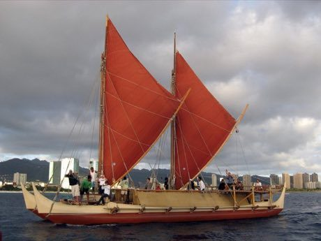

# Wayfinder

*Wayfinding / Hoku-based navigation · Pacific star-path voyage*

**Encyclopedia ID 43** (permanent) · https://bpupadhyaya.github.io/world-heritage-games-site/games/43-wayfinder/

*Photo: HongKongHuey, [CC BY 2.0](https://creativecommons.org/licenses/by/2.0/), [source on Wikimedia Commons](https://commons.wikimedia.org/wiki/File:Hokule'aSailing2009.jpg)*

Sail a double-hulled voyaging canoe across the open ocean, reading stars, swells, birds and clouds to keep a course to an unseen island.

## Heritage note

Part of the living heritage of United States, New Zealand, Micronesia. Some forms of this practice carry deep meaning for the communities who keep it; here we describe the play and the craft only, with respect for its roots.

## Origins

Usually placed in the era of Crossroads and Golden Ages (about 500 to 1500), although its exact origins are uncertain, within the cultural world of Pacific and Oceania.

## Facts

- **Where:** United States, New Zealand, Micronesia
- **Type:** Puzzles and mind games
- **Family:** Puzzle and dexterity toys
- **Era:** [Crossroads and Golden Ages](../../eras/crossroads/index.md) (uncertain)
- **Cradle:** [Pacific and Oceania](../../cradles/pacific/index.md)
- **Region:** Americas

## Related entries

- [Dalgona](../../games/100-dalgona/index.md)
- [Vai Syllabary Decoder](../../games/1394-vai-syllabary-decoder/index.md)
- [Carolinian string figures](../../games/938-carolinian-string-figures/index.md)
- [Maori stick games](../../games/981-maori-stick-games/index.md)
- [Whai](../../games/982-whai/index.md)
- [Marshallese stick chart navigator](../../games/1333-marshallese-stick-chart-navigator/index.md)

## Sources

- <https://commons.wikimedia.org/wiki/File:Hokule'aSailing2009.jpg>
