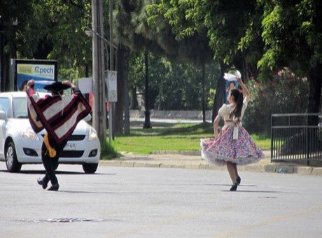

# Cueca

*Cueca · handkerchief courtship dance*

**Encyclopedia ID 430** (permanent) · https://bpupadhyaya.github.io/world-heritage-games-site/games/430-cueca/

*Photo: Rodrigo Fernández, [CC BY-SA 4.0](https://creativecommons.org/licenses/by-sa/4.0/), [source on Wikimedia Commons](https://commons.wikimedia.org/wiki/File:Cueca_en_la_calle_Santiago_2015_dic_f01.jpg)*

A pair of dancers circles and flutters handkerchiefs in a ritualised flirt.

## Heritage note

Part of the living heritage of Chile, Bolivia, Argentina.

## Origins

A living tradition passed from person to person; it is not tied to a single dated origin. It belongs to the cultural world of The Americas: Andes and South America.

## Facts

- **Where:** Chile, Bolivia, Argentina
- **Type:** Dances
- **Family:** Folk and line dances
- **Era:** [Living Traditions](../../eras/living/index.md)
- **Cradle:** [The Americas: Andes and South America](../../cradles/andes-south-america/index.md)
- **Region:** Americas

## Related entries

- [Malambo](../../games/1417-malambo/index.md)
- [Frevo Umbrella Dance](../../games/1411-frevo-umbrella-dance/index.md)
- [Bottle Dance](../../games/1424-bottle-dance/index.md)
- [Marinera Norteña](../../games/1472-marinera-nortena/index.md)
- [Dabke line dance](../../games/37-dabke-line-dance/index.md)
- [Gumboot dance rhythm](../../games/123-gumboot-dance-rhythm/index.md)

## Sources

- <https://commons.wikimedia.org/wiki/File:Cueca_en_la_calle_Santiago_2015_dic_f01.jpg>
