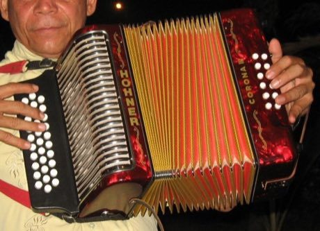

# Vallenato accordion trio

*Also known as: Vallenato*

**Encyclopedia ID 431** (permanent) · https://bpupadhyaya.github.io/world-heritage-games-site/games/431-vallenato-accordion-trio/

*Photo: Jdvillalobos, [Public domain](https://creativecommons.org/publicdomain/mark/1.0/), [source on Wikimedia Commons](https://commons.wikimedia.org/wiki/File:Acorde%C3%B3n_vallenato.jpg)*

Vallenato accordion trio is a musical instrument tradition from Colombia.

## Heritage note

Part of the living heritage of Colombia.

## Origins

A living tradition passed from person to person; it is not tied to a single dated origin. It belongs to the cultural world of The Americas: Andes and South America.

## Facts

- **Where:** Colombia
- **Type:** Musical instruments
- **Family:** Wind instruments
- **Era:** [Living Traditions](../../eras/living/index.md)
- **Cradle:** [The Americas: Andes and South America](../../cradles/andes-south-america/index.md)
- **Region:** Americas

## Play it

[Try a 90-second preview in your browser](https://bpupadhyaya.github.io/games-site/games/vallenato-accordion-trio/play/) · [Google Play](https://play.google.com/store/apps/details?id=com.equalinformation.arcforge.shell) · [App Store](https://apps.apple.com/us/app/arcforge-world-heritage-games/id6813746442)

## Related entries

- [Caballito de totora](../../games/1442-caballito-de-totora/index.md)
- [Khene](../../games/145-khene/index.md)
- [Mijwiz Double Clarinet](../../games/221-mijwiz-double-clarinet/index.md)
- [Mudhif reed-arch house](../../games/230-mudhif-reed-arch-house/index.md)
- [Lusheng](../../games/337-lusheng/index.md)
- [Launeddas Triple Pipe](../../games/400-launeddas-triple-pipe/index.md)

## Sources

- <https://commons.wikimedia.org/wiki/File:Acorde%C3%B3n_vallenato.jpg>
