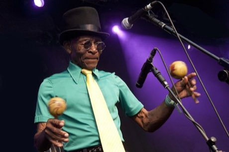

# Mento band

*Mento*

**Encyclopedia ID 432** (permanent) · https://bpupadhyaya.github.io/world-heritage-games-site/games/432-mento-band/

*Photo: Bryan Ledgard, [CC BY 2.0](https://creativecommons.org/licenses/by/2.0/), [source on Wikimedia Commons](https://commons.wikimedia.org/wiki/File:Joseph_%27Powda%27_Bennett,_The_Jolly_Boys_(4854002891).jpg)*

Join a mento string band: pluck the rumba box bass, strum the banjo, shake maracas and keep the offbeat swing while folk verses play.

## Heritage note

Part of the living heritage of Jamaica.

## Origins

A living tradition passed from person to person; it is not tied to a single dated origin. It belongs to the cultural world of The Americas: Caribbean.

## Facts

- **Where:** Jamaica
- **Type:** Musical instruments
- **Family:** String instruments
- **Era:** [Living Traditions](../../eras/living/index.md)
- **Cradle:** [The Americas: Caribbean](../../cradles/caribbean/index.md)
- **Region:** Americas

## Related entries

- [Tres cubano](../../games/433-tres-cubano/index.md)
- [Santur Hammer Strings](../../games/138-santur-hammer-strings/index.md)
- [Dan bau](../../games/143-dan-bau/index.md)
- [Santoor](../../games/151-santoor/index.md)
- [Goje One-String Fiddle](../../games/176-goje-one-string-fiddle/index.md)
- [Masenqo and the azmari](../../games/187-masenqo-and-the-azmari/index.md)

## Sources

- <https://commons.wikimedia.org/wiki/File:Joseph_%27Powda%27_Bennett,_The_Jolly_Boys_(4854002891).jpg>
