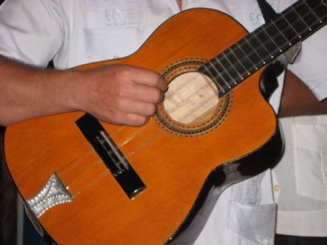

# Tres cubano

*Tres cubano · son guitar*

**Encyclopedia ID 433** (permanent) · https://bpupadhyaya.github.io/world-heritage-games-site/games/433-tres-cubano/

*Photo: dblackadder, [CC BY-SA 2.0](https://creativecommons.org/licenses/by-sa/2.0/), [source on Wikimedia Commons](https://commons.wikimedia.org/wiki/File:Tres_cubano.jpg)*

Strum the three double strings of the tres in the montuno pattern with the clave and bongo beat to build a Cuban son ensemble.

## Heritage note

Part of the living heritage of Cuba.

## Origins

A living tradition passed from person to person; it is not tied to a single dated origin. It belongs to the cultural world of The Americas: Caribbean.

## Facts

- **Where:** Cuba
- **Type:** Musical instruments
- **Family:** String instruments
- **Era:** [Living Traditions](../../eras/living/index.md)
- **Cradle:** [The Americas: Caribbean](../../cradles/caribbean/index.md)
- **Region:** Americas

## Related entries

- [Mento band](../../games/432-mento-band/index.md)
- [Santur Hammer Strings](../../games/138-santur-hammer-strings/index.md)
- [Dan bau](../../games/143-dan-bau/index.md)
- [Santoor](../../games/151-santoor/index.md)
- [Goje One-String Fiddle](../../games/176-goje-one-string-fiddle/index.md)
- [Masenqo and the azmari](../../games/187-masenqo-and-the-azmari/index.md)

## Sources

- <https://commons.wikimedia.org/wiki/File:Tres_cubano.jpg>
