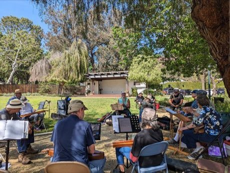

# Mountain dulcimer

*Appalachian*

**Encyclopedia ID 435** (permanent) · https://equalinformation.com/world-heritage-games-site/games/435-mountain-dulcimer/

*Photo: Sdkb, [CC BY-SA 4.0](https://creativecommons.org/licenses/by-sa/4.0/), [source on Wikimedia Commons](https://commons.wikimedia.org/wiki/File:Mountain_dulcimer_jam_in_Claremont%2C_California.jpg)*

Play a fretted lap zither: drone strings plus a melody string, fretted with a noter, strummed to fiddle tunes.

## Heritage note

Part of the living heritage of United States.

## Origins

Usually placed in the era of Classical Worlds (about 1000 BCE to 500 CE), although its exact origins are uncertain, within the cultural world of The Americas: North America.

## Facts

- **Where:** United States
- **Type:** Musical instruments
- **Family:** String instruments
- **Era:** [Classical Worlds](../../eras/classical/index.md) (uncertain)
- **Cradle:** [The Americas: North America](../../cradles/north-america/index.md)
- **Region:** Americas

## Related entries

- [Morin khuur](../../games/34-morin-khuur/index.md)
- [Kathputli string puppets](../../games/79-kathputli-string-puppets/index.md)
- [Valiha tube zither](../../games/124-valiha-tube-zither/index.md)
- [Krar lyre](../../games/126-krar-lyre/index.md)
- [Joropo llanero band](../../games/130-joropo-llanero-band/index.md)
- [Kanklės](../../games/136-kankles/index.md)

## Sources

- <https://commons.wikimedia.org/wiki/File:Mountain_dulcimer_jam_in_Claremont%2C_California.jpg>
