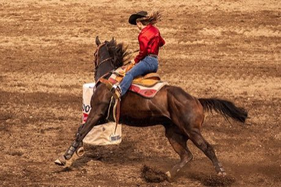

# Barrel racing

**Encyclopedia ID 439** (permanent) · https://bpupadhyaya.github.io/world-heritage-games-site/games/439-barrel-racing/

*Photo: Guywelch2000, [CC0](https://creativecommons.org/publicdomain/zero/1.0/), [source on Wikimedia Commons](https://commons.wikimedia.org/wiki/File:Barrel_racing_at_the_Methow_Valley_Rodeo.jpg)*

Steer a horse around three barrels in a cloverleaf pattern against the clock; knocking a barrel costs time.

## Heritage note

Part of the living heritage of United States, Canada. Animals are partners in this tradition; good care and local rules always come first.

## Origins

Usually placed in the era of Classical Worlds (about 1000 BCE to 500 CE), although its exact origins are uncertain, within the cultural world of The Americas: North America.

## Facts

- **Where:** United States, Canada
- **Type:** Dexterity and skill games
- **Family:** Winter sports
- **Era:** [Classical Worlds](../../eras/classical/index.md) (uncertain)
- **Cradle:** [The Americas: North America](../../cradles/north-america/index.md)
- **Region:** Americas

## Play it

[Try a 90-second preview in your browser](https://bpupadhyaya.github.io/games-site/games/barrel-racing/play/) · [Google Play](https://play.google.com/store/apps/details?id=com.equalinformation.arcforge.shell) · [App Store](https://apps.apple.com/us/app/arcforge-world-heritage-games/id6813746442)

## Related entries

- [Sled dog race](../../games/62-sled-dog-race/index.md)
- [Kottabos Symposium Toss](../../games/392-kottabos-symposium-toss/index.md)
- [Tractor pull](../../games/440-tractor-pull/index.md)
- [Maple taffy on snow](../../games/441-maple-taffy-on-snow/index.md)
- [Axe throwing](../../games/442-axe-throwing/index.md)
- [Skijoring](../../games/490-skijoring/index.md)

## Sources

- <https://commons.wikimedia.org/wiki/File:Barrel_racing_at_the_Methow_Valley_Rodeo.jpg>
