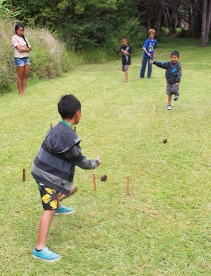

# 'Ulu Maika

*Also known as: ʻUlu maika · Hawaiian disc bowling*

**Encyclopedia ID 44** (permanent) · https://bpupadhyaya.github.io/world-heritage-games-site/games/44-ulu-maika/

*Photo: Hawai'i Volcanoes NPS, [Public domain](https://creativecommons.org/publicdomain/mark/1.0/), [source on Wikimedia Commons](https://commons.wikimedia.org/wiki/File:Keiki_engage_in_‘ulu_maika_--_Hawaiian_bowling_game_(48877865742).jpg)*

Roll a smooth stone disc (maika) between two stakes set a few paces apart, and across a distance to hit a far stake.

## Heritage note

Part of the living heritage of United States. Some forms of this practice carry deep meaning for the communities who keep it; here we describe the play and the craft only, with respect for its roots.

## Origins

Usually placed in the era of Age of Contact and Craft (about 1500 to 1800), although its exact origins are uncertain, within the cultural world of Pacific and Oceania.

## Facts

- **Where:** United States
- **Type:** Dexterity and skill games
- **Family:** Winter sports
- **Era:** [Age of Contact and Craft](../../eras/contact/index.md) (uncertain)
- **Cradle:** [Pacific and Oceania](../../cradles/pacific/index.md)
- **Region:** Americas

## Play it

[Try a 90-second preview in your browser](https://bpupadhyaya.github.io/games-site/games/ulu-maika/play/) · [Google Play](https://play.google.com/store/apps/details?id=com.equalinformation.arcforge.shell) · [App Store](https://apps.apple.com/us/app/arcforge-world-heritage-games/id6813746442)

## Related entries

- [Finnish pin toss](../../games/49-finnish-pin-toss/index.md)
- [Sled dog race](../../games/62-sled-dog-race/index.md)
- [Canal ice-skating marathon](../../games/84-canal-ice-skating-marathon/index.md)
- [Kicksled Race](../../games/407-kicksled-race/index.md)
- [Candlepin bowling](../../games/444-candlepin-bowling/index.md)
- [Luge and toboggan run](../../games/482-luge-and-toboggan-run/index.md)

## Sources

- <https://commons.wikimedia.org/wiki/File:Keiki_engage_in_‘ulu_maika_--_Hawaiian_bowling_game_(48877865742).jpg>
