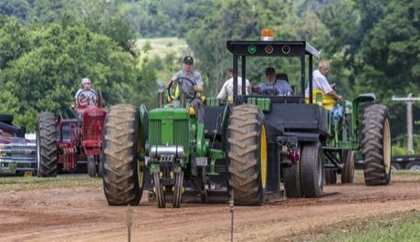

# Tractor pull

**Encyclopedia ID 440** (permanent) · https://bpupadhyaya.github.io/world-heritage-games-site/games/440-tractor-pull/

*Photo: Acroterion, [CC BY-SA 4.0](https://creativecommons.org/licenses/by-sa/4.0/), [source on Wikimedia Commons](https://commons.wikimedia.org/wiki/File:John_Deere_70_tractor_pulling_MD1.jpg)*

Hitch a tractor to a weighted sled that grows heavier as it moves, and pull it the farthest down the track.

## Heritage note

Part of the living heritage of United States, Canada.

## Origins

Usually placed in the era of Modern Heritage (1800 to today), although its exact origins are uncertain, within the cultural world of The Americas: North America.

## Facts

- **Where:** United States, Canada
- **Type:** Puzzles and mind games
- **Family:** Winter sports
- **Era:** [Modern Heritage](../../eras/modern/index.md) (uncertain)
- **Cradle:** [The Americas: North America](../../cradles/north-america/index.md)
- **Region:** Americas

## Play it

[Try a 90-second preview in your browser](https://bpupadhyaya.github.io/games-site/games/tractor-pull/play/) · [Google Play](https://play.google.com/store/apps/details?id=com.equalinformation.arcforge.shell) · App Store (coming soon)

## Related entries

- [Axe throwing](../../games/442-axe-throwing/index.md)
- [Chinlone](../../games/16-chinlone/index.md)
- [Pinata swing](../../games/61-pinata-swing/index.md)
- [Sled dog race](../../games/62-sled-dog-race/index.md)
- [Ring Tilting](../../games/65-ring-tilting/index.md)
- [Yukigassen Snow Fort](../../games/71-yukigassen-snow-fort/index.md)

## Sources

- <https://commons.wikimedia.org/wiki/File:John_Deere_70_tractor_pulling_MD1.jpg>
