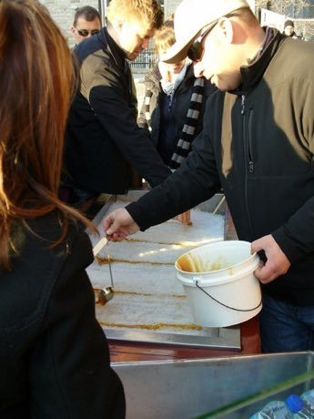

# Maple taffy on snow

*Also known as: tire d'erable · tire sur la neige*

**Encyclopedia ID 441** (permanent) · https://bpupadhyaya.github.io/world-heritage-games-site/games/441-maple-taffy-on-snow/

*Photo: John Barnett, [CC BY-SA 4.0](https://creativecommons.org/licenses/by-sa/4.0/), [source on Wikimedia Commons](https://commons.wikimedia.org/wiki/File:Tirederable-MapleTaffy1.jpg)*

Pour hot maple syrup in lines on packed snow, then roll it up on a stick once it sets.

## Heritage note

Part of the living heritage of Canada.

## Origins

A living tradition passed from person to person; it is not tied to a single dated origin. It belongs to the cultural world of The Americas: North America.

## Facts

- **Where:** Canada
- **Type:** Crafts and making
- **Family:** Winter sports
- **Era:** [Living Traditions](../../eras/living/index.md)
- **Cradle:** [The Americas: North America](../../cradles/north-america/index.md)
- **Region:** Americas

## Related entries

- [Sled dog race](../../games/62-sled-dog-race/index.md)
- [Wire car](../../games/85-wire-car/index.md)
- [Bamboo scaffold builder](../../games/369-bamboo-scaffold-builder/index.md)
- [Neon sign bender](../../games/371-neon-sign-bender/index.md)
- [Barrel racing](../../games/439-barrel-racing/index.md)
- [Tractor pull](../../games/440-tractor-pull/index.md)

## Sources

- <https://commons.wikimedia.org/wiki/File:Tirederable-MapleTaffy1.jpg>
