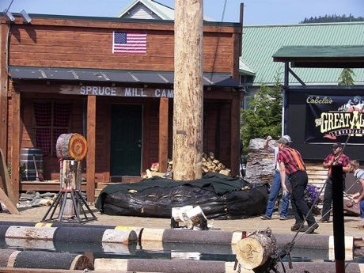

# Axe throwing

**Encyclopedia ID 442** (permanent) · https://bpupadhyaya.github.io/world-heritage-games-site/games/442-axe-throwing/

*Photo: Wknight94, [CC BY-SA 3.0](https://creativecommons.org/licenses/by-sa/3.0/), [source on Wikimedia Commons](https://commons.wikimedia.org/wiki/File:Andy_Colle_axe_throwing_2.jpg)*

Throw a hatchet so it sticks in a concentric-ring wooden target, scoring by ring.

## Heritage note

Part of the living heritage of Canada, United States. It is presented as sport and skill, never as real fighting.

## Origins

Usually placed in the era of Modern Heritage (1800 to today), although its exact origins are uncertain, within the cultural world of The Americas: North America.

## Facts

- **Where:** Canada, United States
- **Type:** Dexterity and skill games
- **Family:** Winter sports
- **Era:** [Modern Heritage](../../eras/modern/index.md) (uncertain)
- **Cradle:** [The Americas: North America](../../cradles/north-america/index.md)
- **Region:** Americas

## Play it

[Web preview](https://bpupadhyaya.github.io/) · [Google Play](https://play.google.com/store/apps/details?id=com.equalinformation.arcforge.shell) · [App Store](https://apps.apple.com/us/app/arcforge-world-heritage-games/id6813746442)

## Related entries

- [Tractor pull](../../games/440-tractor-pull/index.md)
- [Chinlone](../../games/16-chinlone/index.md)
- [Pinata swing](../../games/61-pinata-swing/index.md)
- [Sled dog race](../../games/62-sled-dog-race/index.md)
- [Ring Tilting](../../games/65-ring-tilting/index.md)
- [Yukigassen Snow Fort](../../games/71-yukigassen-snow-fort/index.md)

## Sources

- <https://commons.wikimedia.org/wiki/File:Andy_Colle_axe_throwing_2.jpg>
