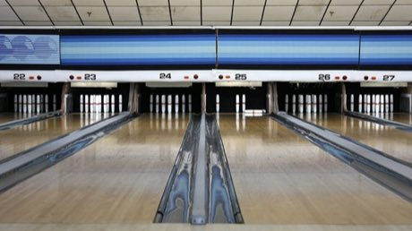

# Candlepin bowling

**Encyclopedia ID 444** (permanent) · https://equalinformation.com/world-heritage-games-site/games/444-candlepin-bowling/

*Photo: Rene Schwietzke, [CC BY 3.0](https://creativecommons.org/licenses/by/3.0/), [source on Wikimedia Commons](https://commons.wikimedia.org/wiki/File:Candlepin-bowling-usa-lanes-rs.jpg)*

Roll a small hand-sized ball at ten slim pins with three rolls per frame; fallen pins stay on the lane as obstacles.

## Heritage note

Part of the living heritage of United Kingdom, Canada.

## Origins

Usually placed in the era of Age of Contact and Craft (about 1500 to 1800), although its exact origins are uncertain, within the cultural world of Celtic and Atlantic Europe.

## Facts

- **Where:** United Kingdom, Canada
- **Type:** Dexterity and skill games
- **Family:** Winter sports
- **Era:** [Age of Contact and Craft](../../eras/contact/index.md) (uncertain)
- **Cradle:** [Celtic and Atlantic Europe](../../cradles/celtic-atlantic/index.md)
- **Region:** Europe

## Related entries

- [Frisian Road Bowling](../../games/1441-frisian-road-bowling/index.md)
- [Finnish pin toss](../../games/49-finnish-pin-toss/index.md)
- [Sled dog race](../../games/62-sled-dog-race/index.md)
- [Bagatelle](../../games/72-bagatelle/index.md)
- [Bat and Trap](../../games/405-bat-and-trap/index.md)
- [Kicksled Race](../../games/407-kicksled-race/index.md)

## Sources

- <https://commons.wikimedia.org/wiki/File:Candlepin-bowling-usa-lanes-rs.jpg>
