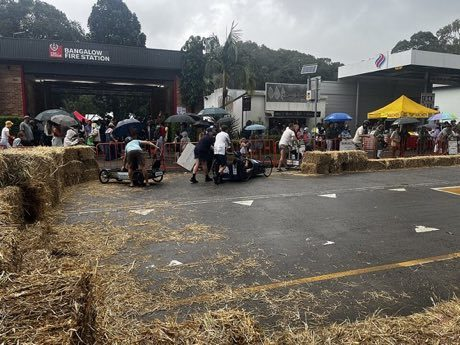

# Billycart derby

**Encyclopedia ID 445** (permanent) · https://bpupadhyaya.github.io/world-heritage-games-site/games/445-billycart-derby/

*Photo: Aliceinthealice, [CC0](https://creativecommons.org/publicdomain/zero/1.0/), [source on Wikimedia Commons](https://commons.wikimedia.org/wiki/File:Bangalow_Billycart_Derby_04.jpg)*

Build a gravity-powered cart, choose wheels and steering, then race it down a hill against others.

## Heritage note

Part of the living heritage of Australia.

## Origins

Usually placed in the era of Age of Contact and Craft (about 1500 to 1800), although its exact origins are uncertain, within the cultural world of Pacific and Oceania.

## Facts

- **Where:** Australia
- **Type:** Racing
- **Era:** [Age of Contact and Craft](../../eras/contact/index.md) (uncertain)
- **Cradle:** [Pacific and Oceania](../../cradles/pacific/index.md)
- **Region:** Oceania and Pacific

## Play it

[Try a 90-second preview in your browser](https://bpupadhyaya.github.io/games-site/games/billycart-derby/play/) · [Google Play](https://play.google.com/store/apps/details?id=com.equalinformation.arcforge.shell) · App Store (coming soon)

## Related entries

- [Beach flags](../../games/446-beach-flags/index.md)
- [Backyard cricket](../../games/559-backyard-cricket/index.md)
- [Two-up](../../games/560-two-up/index.md)
- ['Ulu Maika](../../games/44-ulu-maika/index.md)
- [Samoan cricket](../../games/1056-samoan-cricket/index.md)
- [Pasifika kirikiti](../../games/980-pasifika-kirikiti/index.md)

## Sources

- <https://commons.wikimedia.org/wiki/File:Bangalow_Billycart_Derby_04.jpg>
