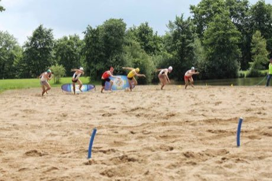

# Beach flags

**Encyclopedia ID 446** (permanent) · https://bpupadhyaya.github.io/world-heritage-games-site/games/446-beach-flags/

*Photo: MisterGael, [CC BY-SA 3.0](https://creativecommons.org/licenses/by-sa/3.0/), [source on Wikimedia Commons](https://commons.wikimedia.org/wiki/File:Beach_flag.jpg)*

Racers lie face-down on sand, spin on the whistle, sprint and grab one of fewer flags than racers.

## Heritage note

Part of the living heritage of Australia.

## Origins

Usually placed in the era of Age of Contact and Craft (about 1500 to 1800), although its exact origins are uncertain, within the cultural world of Pacific and Oceania.

## Facts

- **Where:** Australia
- **Type:** Racing
- **Era:** [Age of Contact and Craft](../../eras/contact/index.md) (uncertain)
- **Cradle:** [Pacific and Oceania](../../cradles/pacific/index.md)
- **Region:** Oceania and Pacific

## Related entries

- [Billycart derby](../../games/445-billycart-derby/index.md)
- [Two-up](../../games/560-two-up/index.md)
- [Samoan cricket](../../games/1056-samoan-cricket/index.md)
- [Pasifika kirikiti](../../games/980-pasifika-kirikiti/index.md)
- [Tongan cricket](../../games/1149-tongan-cricket/index.md)
- [Fuu Fuu Penu](../../games/1171-fuu-fuu-penu/index.md)

## Sources

- <https://commons.wikimedia.org/wiki/File:Beach_flag.jpg>
