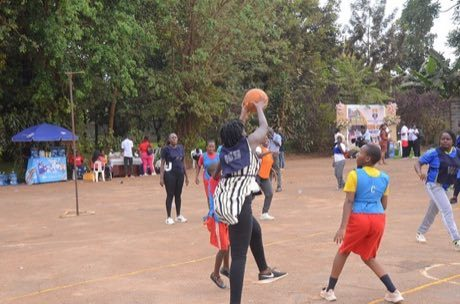

# Netball

**Encyclopedia ID 447** (permanent) · https://bpupadhyaya.github.io/world-heritage-games-site/games/447-netball/

*Photo: Samson Ssemakadde, [CC0](https://creativecommons.org/publicdomain/zero/1.0/), [source on Wikimedia Commons](https://commons.wikimedia.org/wiki/File:Netball_match.jpg)*

Seven-a-side ball game: pass without dribbling or moving with the ball, and shoot into a ring from the goal circle.

## Heritage note

Part of the living heritage of Australia, United Kingdom.

## Origins

Usually placed in the era of Modern Heritage (1800 to today), although its exact origins are uncertain, within the cultural world of Pacific and Oceania.

## Facts

- **Where:** Australia, United Kingdom
- **Type:** Team ball sports
- **Family:** Water sports
- **Era:** [Modern Heritage](../../eras/modern/index.md) (uncertain)
- **Cradle:** [Pacific and Oceania](../../cradles/pacific/index.md)
- **Region:** Oceania and Pacific

## Related entries

- [Pole-and-line tuna fishing from a masdhoni](../../games/1334-pole-and-line-tuna-fishing-from-a-masdhoni/index.md)
- [Haenyeo Breath Dive](../../games/1459-haenyeo-breath-dive/index.md)
- [Voyageur canoe racing](../../games/6366-voyageur-canoe-racing/index.md)
- [Matkot](../../games/825-matkot/index.md)
- [Kataw](../../games/873-kataw/index.md)
- [Mixtec ball game](../../games/936-mixtec-ball-game/index.md)

## Sources

- <https://commons.wikimedia.org/wiki/File:Netball_match.jpg>
