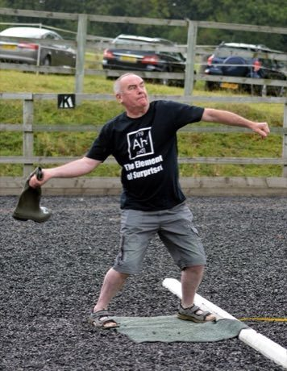

# Gumboot throwing

*Also known as: wellie wanging*

**Encyclopedia ID 448** (permanent) · https://bpupadhyaya.github.io/world-heritage-games-site/games/448-gumboot-throwing/

*Photo: Russ Hamer, [CC BY-SA 4.0](https://creativecommons.org/licenses/by-sa/4.0/), [source on Wikimedia Commons](https://commons.wikimedia.org/wiki/File:Wellie_Wanging._One_handed_forward_throw_method.JPG)*

Throw a rubber boot as far as possible from a mat within a lane, using a swinging release.

## Heritage note

Part of the living heritage of New Zealand, United Kingdom.

## Origins

Usually placed in the era of Modern Heritage (1800 to today), although its exact origins are uncertain, within the cultural world of Pacific and Oceania.

## Facts

- **Where:** New Zealand, United Kingdom
- **Type:** Puzzles and mind games
- **Era:** [Modern Heritage](../../eras/modern/index.md) (uncertain)
- **Cradle:** [Pacific and Oceania](../../cradles/pacific/index.md)
- **Region:** Oceania and Pacific

## Related entries

- [Netball](../../games/447-netball/index.md)
- [Kī-o-rahi](../../games/978-ki-o-rahi/index.md)
- [Maori stick games](../../games/981-maori-stick-games/index.md)
- [Wave riding](../../games/76-wave-riding/index.md)
- [Axemen woodchop](../../games/1232-axemen-woodchop/index.md)
- [Marshallese stick chart navigator](../../games/1333-marshallese-stick-chart-navigator/index.md)

## Sources

- <https://commons.wikimedia.org/wiki/File:Wellie_Wanging._One_handed_forward_throw_method.JPG>
