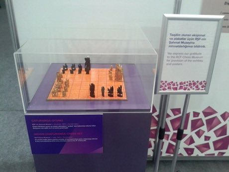

# Chaturanga

*Also known as: चतुरङ्ग · ancestor of chess*

**Encyclopedia ID 45** (permanent) · https://bpupadhyaya.github.io/world-heritage-games-site/games/45-chaturanga/

*Photo: Nicat49, [CC BY-SA 4.0](https://creativecommons.org/licenses/by-sa/4.0/), [source on Wikimedia Commons](https://commons.wikimedia.org/wiki/File:Indian_Chaturanga_Chess_Set.jpg)*

Two armies of chariot, horse, elephant and foot soldiers move on an 8x8 ashtapada board; the aim is to capture the opposing king, with no queen and no castling.

## Heritage note

Part of the living heritage of India.

## Origins

Usually placed in the era of Crossroads and Golden Ages (about 500 to 1500), although its exact origins are uncertain, within the cultural world of South Asia.

## Facts

- **Where:** India
- **Type:** Board and table games
- **Family:** Chess family
- **Era:** [Crossroads and Golden Ages](../../eras/crossroads/index.md) (uncertain)
- **Cradle:** [South Asia](../../cradles/south-asia/index.md)
- **Region:** South and Central Asia

## Play it

[Web preview](https://bpupadhyaya.github.io/) · [Google Play](https://play.google.com/store/apps/details?id=com.equalinformation.arcforge.shell) · [App Store](https://apps.apple.com/us/app/arcforge-world-heritage-games/id6813746442)

## Related entries

- [Maldivian chess](../../games/917-maldivian-chess/index.md)
- [Sittuyin](../../games/302-sittuyin/index.md)
- [Chess](../../games/552-chess/index.md)
- [Luzhanqi](../../games/640-luzhanqi/index.md)
- [Senterej](../../games/707-senterej/index.md)
- [Hasami shogi](../../games/849-hasami-shogi/index.md)

## Sources

- <https://commons.wikimedia.org/wiki/File:Indian_Chaturanga_Chess_Set.jpg>
