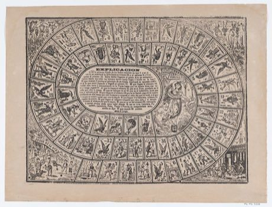

# Game of the Goose

*Gioco dell'Oca / Juego de la Oca / Jeu de l'Oie*

**Encyclopedia ID 450** (permanent) · https://equalinformation.com/world-heritage-games-site/games/450-game-of-the-goose/

*Photo: Antonio Vanegas Arroyo / José Guadalupe Posada (Met Museum), [CC0](https://creativecommons.org/publicdomain/zero/1.0/), [source on Wikimedia Commons](https://commons.wikimedia.org/wiki/File:Game_of_the_Goose_MET_DP867954.jpg)*

Roll two dice and race along a 63-space spiral; geese squares double your roll, while the bridge, inn, well, maze and death square jump, hold or reset you.

## Heritage note

Part of the living heritage of Italy, Spain, France.

## Origins

Usually placed in the era of River Valleys and First Cities (about 3000 to 1000 BCE), although its exact origins are uncertain, within the cultural world of Mediterranean.

## Facts

- **Where:** Italy, Spain, France
- **Type:** Board and table games
- **Family:** Dice and knucklebone games
- **Era:** [River Valleys and First Cities](../../eras/river-valleys/index.md) (uncertain)
- **Cradle:** [Mediterranean](../../cradles/mediterranean/index.md)
- **Region:** Europe

## Related entries

- [Parxís](../../games/542-parxis/index.md)
- [Sho](../../games/286-sho/index.md)
- [Liubo](../../games/331-liubo/index.md)
- [E-sugoroku](../../games/348-e-sugoroku/index.md)
- [Generala](../../games/422-generala/index.md)
- [Sáhkku](../../games/451-sahkku/index.md)

## Sources

- <https://commons.wikimedia.org/wiki/File:Game_of_the_Goose_MET_DP867954.jpg>
