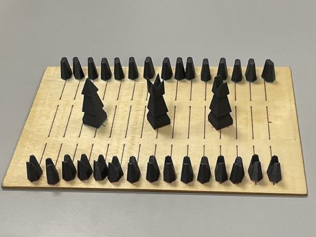

# Sáhkku

*Also known as: Sáhkku (Sámi)*

**Encyclopedia ID 451** (permanent) · https://bpupadhyaya.github.io/world-heritage-games-site/games/451-sahkku/

*Photo: Bjarne Bjørnevik (WMNO), [CC BY 4.0](https://creativecommons.org/licenses/by/4.0/), [source on Wikimedia Commons](https://commons.wikimedia.org/wiki/File:S%C3%A1hkku_board.jpg)*

Roll four-sided Sámi dice to wake sleeping reindeer-herders, march them around a long track and capture rivals by landing on them; a neutral king joins whichever side captures him.

## Heritage note

A tradition shared by communities in many places.

## Origins

Usually placed in the era of River Valleys and First Cities (about 3000 to 1000 BCE), although its exact origins are uncertain.

## Facts

- **Where:** Shared across many places
- **Type:** Board and table games
- **Family:** Dice and knucklebone games
- **Era:** [River Valleys and First Cities](../../eras/river-valleys/index.md) (uncertain)
- **Cradle:** [Shared across the world](../../cradles/worldwide/index.md)
- **Region:** Europe

## Play it

[Web preview](https://bpupadhyaya.github.io/) · [Google Play](https://play.google.com/store/apps/details?id=com.equalinformation.arcforge.shell) · [App Store](https://apps.apple.com/us/app/arcforge-world-heritage-games/id6813746442)

## Related entries

- [Sho](../../games/286-sho/index.md)
- [Liubo](../../games/331-liubo/index.md)
- [E-sugoroku](../../games/348-e-sugoroku/index.md)
- [Generala](../../games/422-generala/index.md)
- [Game of the Goose](../../games/450-game-of-the-goose/index.md)
- [Cacho](../../games/595-cacho/index.md)

## Sources

- <https://commons.wikimedia.org/wiki/File:S%C3%A1hkku_board.jpg>
