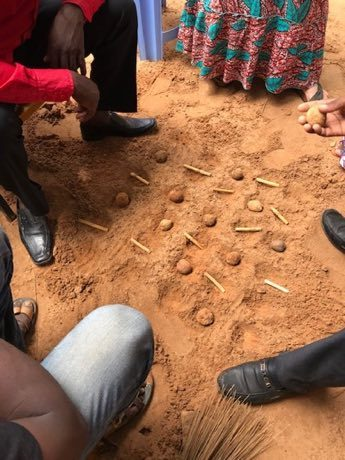

# Dara

*Dara / Dili / Doki · Dili (Dara) · Doki*

**Encyclopedia ID 452** (permanent) · https://equalinformation.com/world-heritage-games-site/games/452-dara/

*Photo: Seberle, [CC BY-SA 4.0](https://creativecommons.org/licenses/by-sa/4.0/), [source on Wikimedia Commons](https://commons.wikimedia.org/wiki/File:Dili2.jpg)*

Each player drops 12 stones onto a 5x6 grid, then slides them; making exactly three in a row captures an enemy stone, and the first to take enough pieces wins.

## Heritage note

Part of the living heritage of Nigeria, Niger.

## Origins

A living tradition passed from person to person; it is not tied to a single dated origin. It belongs to the cultural world of Africa: Sahel, West and Central.

## Facts

- **Where:** Nigeria, Niger
- **Type:** Crafts and making
- **Era:** [Living Traditions](../../eras/living/index.md)
- **Cradle:** [Africa: Sahel, West and Central](../../cradles/africa-west/index.md)
- **Region:** Sub-Saharan Africa
- **Players:** 2

## Related entries

- [Talking drum](../../games/33-talking-drum/index.md)
- [Adire indigo resist dyeing](../../games/87-adire-indigo-resist-dyeing/index.md)
- [Goje One-String Fiddle](../../games/176-goje-one-string-fiddle/index.md)
- [Calabash Water Drum](../../games/180-calabash-water-drum/index.md)
- [Ikpu Ite Coil Pot](../../games/1300-ikpu-ite-coil-pot/index.md)
- [Tuareg Tea](../../games/1390-tuareg-tea/index.md)

## Sources

- <https://commons.wikimedia.org/wiki/File:Dili2.jpg>
- <https://en.wikipedia.org/wiki/Dara_(game)>
- <https://newventuregames.com/products/dara>
