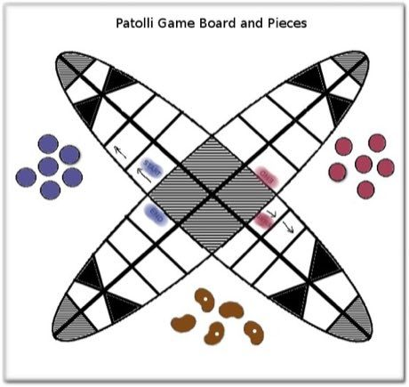

# Patolli

**Encyclopedia ID 454** (permanent) · https://bpupadhyaya.github.io/world-heritage-games-site/games/454-patolli/

*Photo: Tony.freeman, [CC BY-SA 3.0](https://creativecommons.org/licenses/by-sa/3.0/), [source on Wikimedia Commons](https://commons.wikimedia.org/wiki/File:Patolli-board.jpg)*

Throw five marked beans to move six pieces around an X-shaped track with trap squares; the aim is to bring all pieces round before your opponent.

## Heritage note

Part of the living heritage of Mexico. Some forms of this practice carry deep meaning for the communities who keep it; here we describe the play and the craft only, with respect for its roots.

## Origins

Usually placed in the era of Crossroads and Golden Ages (about 500 to 1500), although its exact origins are uncertain, within the cultural world of The Americas: Mesoamerica.

## Facts

- **Where:** Mexico
- **Type:** Board and table games
- **Family:** Dice and knucklebone games
- **Era:** [Crossroads and Golden Ages](../../eras/crossroads/index.md) (uncertain)
- **Cradle:** [The Americas: Mesoamerica](../../cradles/meso-america/index.md)
- **Region:** Americas

## Related entries

- [Daldøs](../../games/458-dalds/index.md)
- [Sig](../../games/928-sig/index.md)
- [Mexican Lotería](../../games/935-mexican-loteria/index.md)
- [Jacks](../../games/697-jacks/index.md)
- [Sho](../../games/286-sho/index.md)
- [Liubo](../../games/331-liubo/index.md)

## Sources

- <https://commons.wikimedia.org/wiki/File:Patolli-board.jpg>
