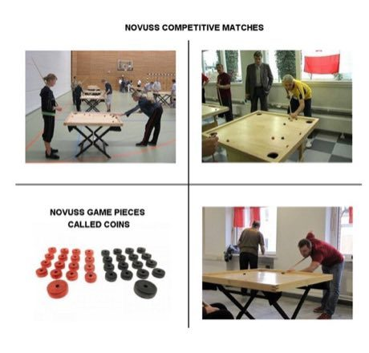

# Novuss

*Novuss / Koroona*

**Encyclopedia ID 456** (permanent) · https://equalinformation.com/world-heritage-games-site/games/456-novuss/

*Photo: DVQuebec, [CC BY-SA 4.0](https://creativecommons.org/licenses/by-sa/4.0/), [source on Wikimedia Commons](https://commons.wikimedia.org/wiki/File:NOVUSS_PLAYERS_AND_EQUIPMENT.jpg)*

Stand at one edge of a small square table and use a cue to shoot the striker puck into 16 discs, pocketing your eight colour before your opponent.

## Heritage note

Part of the living heritage of Latvia, Estonia.

## Origins

Usually placed in the era of Crossroads and Golden Ages (about 500 to 1500), although its exact origins are uncertain, within the cultural world of Northern and Eastern Europe.

## Facts

- **Where:** Latvia, Estonia
- **Type:** Board and table games
- **Era:** [Crossroads and Golden Ages](../../eras/crossroads/index.md) (uncertain)
- **Cradle:** [Northern and Eastern Europe](../../cradles/north-east-europe/index.md)
- **Region:** Europe

## Related entries

- [Latvian Bagpipe and Folk Pipes](../../games/1324-latvian-bagpipe-and-folk-pipes/index.md)
- [Hornussen](../../games/10-hornussen/index.md)
- [Daldøs](../../games/458-dalds/index.md)
- [Czech draughts](../../games/662-czech-draughts/index.md)
- [Hungarian dominoes](../../games/778-hungarian-dominoes/index.md)
- [Tafl](../../games/995-tafl/index.md)

## Sources

- <https://commons.wikimedia.org/wiki/File:NOVUSS_PLAYERS_AND_EQUIPMENT.jpg>
