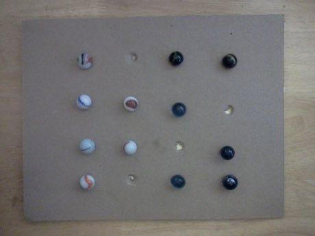

# Four-Field Kono

*Also known as: Sa-p'an Kono · 사방고누*

**Encyclopedia ID 457** (permanent) · https://bpupadhyaya.github.io/world-heritage-games-site/games/457-four-field-kono/

*Photo: Eladynnus, [CC0](https://creativecommons.org/publicdomain/zero/1.0/), [source on Wikimedia Commons](https://commons.wikimedia.org/wiki/File:Fourfieldkono.jpg)*

Move pieces one step along a 4x4 point board and jump over an enemy to capture it; the fewer pieces you have left, the more the board opens.

## Heritage note

Part of the living heritage of South Korea.

## Origins

Usually placed in the era of Crossroads and Golden Ages (about 500 to 1500), although its exact origins are uncertain, within the cultural world of Japan and Korea.

## Facts

- **Where:** South Korea
- **Type:** Board and table games
- **Era:** [Crossroads and Golden Ages](../../eras/crossroads/index.md) (uncertain)
- **Cradle:** [Japan and Korea](../../cradles/japan-korea/index.md)
- **Region:** East and Southeast Asia

## Play it

[Try a 90-second preview in your browser](https://bpupadhyaya.github.io/games-site/games/four-field-kono/play/) · [Google Play](https://play.google.com/store/apps/details?id=com.equalinformation.arcforge.shell) · [App Store](https://apps.apple.com/us/app/arcforge-world-heritage-games/id6813746442)

## Related entries

- [Dalgona](../../games/100-dalgona/index.md)
- [Janggi](../../games/1081-janggi/index.md)
- [Gomoku and Renju](../../games/847-gomoku-and-renju/index.md)
- [Hasami shogi](../../games/849-hasami-shogi/index.md)
- [Riichi mahjong](../../games/851-riichi-mahjong/index.md)
- [Shogi](../../games/852-shogi/index.md)

## Sources

- <https://commons.wikimedia.org/wiki/File:Fourfieldkono.jpg>
