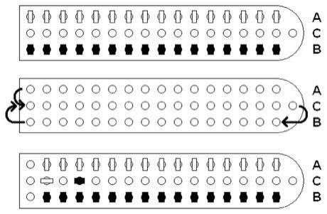

# Daldøs

**Encyclopedia ID 458** (permanent) · https://bpupadhyaya.github.io/world-heritage-games-site/games/458-dalds/

*Photo: Noe (Wikimedia Commons), [Public domain](https://creativecommons.org/publicdomain/mark/1.0/), [source on Wikimedia Commons](https://commons.wikimedia.org/wiki/File:Dald%C3%B8s.PNG)*

Move 16 spatula-shaped pieces along a boat-shaped, three-row board by throwing a four-sided stick die; pieces turn to show their state and land to capture.

## Heritage note

Part of the living heritage of Denmark, Norway.

## Origins

Usually placed in the era of Crossroads and Golden Ages (about 500 to 1500), although its exact origins are uncertain, within the cultural world of Northern and Eastern Europe.

## Facts

- **Where:** Denmark, Norway
- **Type:** Board and table games
- **Family:** Dice and knucklebone games
- **Era:** [Crossroads and Golden Ages](../../eras/crossroads/index.md) (uncertain)
- **Cradle:** [Northern and Eastern Europe](../../cradles/north-east-europe/index.md)
- **Region:** Europe

## Play it

[Web preview](https://bpupadhyaya.github.io/) · [Google Play](https://play.google.com/store/apps/details?id=com.equalinformation.arcforge.shell) · [App Store](https://apps.apple.com/us/app/arcforge-world-heritage-games/id6813746442)

## Related entries

- [Patolli](../../games/454-patolli/index.md)
- [Sig](../../games/928-sig/index.md)
- [Tafl](../../games/995-tafl/index.md)
- [Hornussen](../../games/10-hornussen/index.md)
- [Balalaika](../../games/133-balalaika/index.md)
- [Sho](../../games/286-sho/index.md)

## Sources

- <https://commons.wikimedia.org/wiki/File:Dald%C3%B8s.PNG>
