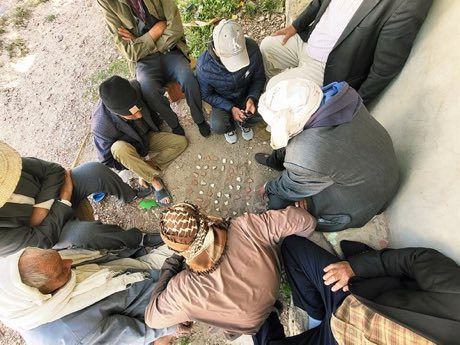

# Kharbaga

*خربقة (Kharbaga)*

**Encyclopedia ID 459** (permanent) · https://bpupadhyaya.github.io/world-heritage-games-site/games/459-kharbaga/

*Photo: Nagaboussi, [CC BY-SA 4.0](https://creativecommons.org/licenses/by-sa/4.0/), [source on Wikimedia Commons](https://commons.wikimedia.org/wiki/File:Kharbaga_Game_01.jpg)*

Each side has 20 pieces on a 5x5 grid and advances forward only; a piece reaching the far rank becomes a 'Mullah' who moves in any direction, and the aim is to capture every enemy piece.

## Heritage note

Part of the living heritage of Morocco.

## Origins

Usually placed in the era of Crossroads and Golden Ages (about 500 to 1500), although its exact origins are uncertain, within the cultural world of Mediterranean.

## Facts

- **Where:** Morocco
- **Type:** Board and table games
- **Family:** Draughts and capture games
- **Era:** [Crossroads and Golden Ages](../../eras/crossroads/index.md) (uncertain)
- **Cradle:** [Mediterranean](../../cradles/mediterranean/index.md)
- **Region:** Middle East and North Africa

## Related entries

- [Zamma](../../games/462-zamma/index.md)
- [Italian draughts](../../games/834-italian-draughts/index.md)
- [Turkish Dama](../../games/155-turkish-dama/index.md)
- [Yote Capture Grid](../../games/167-yote-capture-grid/index.md)
- [Peralikatuma](../../games/287-peralikatuma/index.md)
- [Sholo Guti](../../games/461-sholo-guti/index.md)

## Sources

- <https://commons.wikimedia.org/wiki/File:Kharbaga_Game_01.jpg>
