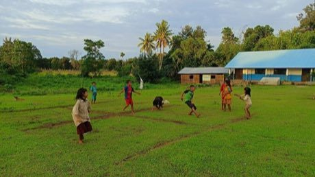

# Gobak Sodor

*Gobak Sodor / Galah Asin · line-guard tag*

**Encyclopedia ID 46** (permanent) · https://equalinformation.com/world-heritage-games-site/games/46-gobak-sodor/

*Photo: Sofi Solihah, [CC BY-SA 4.0](https://creativecommons.org/licenses/by-sa/4.0/), [source on Wikimedia Commons](https://commons.wikimedia.org/wiki/File:Bermain_Gobak_Sodor_di_Sumba_Barat_Daya.jpg)*

the other team must run through every line to the end and back without being touched.

## Heritage note

Part of the living heritage of Indonesia, Malaysia.

## Origins

Usually placed in the era of Deep Past and First Games (before about 3000 BCE), although its exact origins are uncertain, within the cultural world of Southeast Asia and the Islands.

## Facts

- **Where:** Indonesia, Malaysia
- **Type:** Board and table games
- **Era:** [Deep Past and First Games](../../eras/deep-past/index.md) (uncertain)
- **Cradle:** [Southeast Asia and the Islands](../../cradles/southeast-asia/index.md)
- **Region:** East and Southeast Asia

## Related entries

- [Congklak](../../games/803-congklak/index.md)
- [Five stones](../../games/907-five-stones/index.md)
- [Galah panjang](../../games/909-galah-panjang/index.md)
- [Seed throwing](../../games/612-seed-throwing/index.md)
- [Pebbles](../../games/874-pebbles/index.md)
- [Tag](../../games/959-tag/index.md)

## Sources

- <https://commons.wikimedia.org/wiki/File:Bermain_Gobak_Sodor_di_Sumba_Barat_Daya.jpg>
