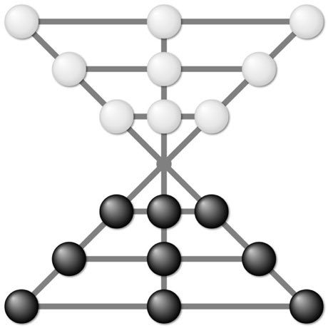

# Lau Kata Kati

*লাউ কাটা কাটি*

**Encyclopedia ID 460** (permanent) · https://equalinformation.com/world-heritage-games-site/games/460-lau-kata-kati/

*Photo: Life of Riley, [CC BY-SA 4.0](https://creativecommons.org/licenses/by-sa/4.0/), [source on Wikimedia Commons](https://commons.wikimedia.org/wiki/File:Lau_kata_kati.svg)*

Nine pieces each on a board of two triangles meeting at a point; jump over enemy pieces to capture all of them or stalemate the opponent.

## Heritage note

Part of the living heritage of Bangladesh. Animals are partners in this tradition; good care and local rules always come first.

## Origins

Usually placed in the era of Crossroads and Golden Ages (about 500 to 1500), although its exact origins are uncertain, within the cultural world of South Asia.

## Facts

- **Where:** Bangladesh
- **Type:** Board and table games
- **Era:** [Crossroads and Golden Ages](../../eras/crossroads/index.md) (uncertain)
- **Cradle:** [South Asia](../../cradles/south-asia/index.md)
- **Region:** South and Central Asia

## Related entries

- [Sholo Guti](../../games/461-sholo-guti/index.md)
- [Chaturanga](../../games/45-chaturanga/index.md)
- [Rabab plucked lute](../../games/270-rabab-plucked-lute/index.md)
- [Veena](../../games/282-veena/index.md)
- [Peralikatuma](../../games/287-peralikatuma/index.md)
- [Lambs and Tigers](../../games/791-lambs-and-tigers/index.md)

## Sources

- <https://commons.wikimedia.org/wiki/File:Lau_kata_kati.svg>
